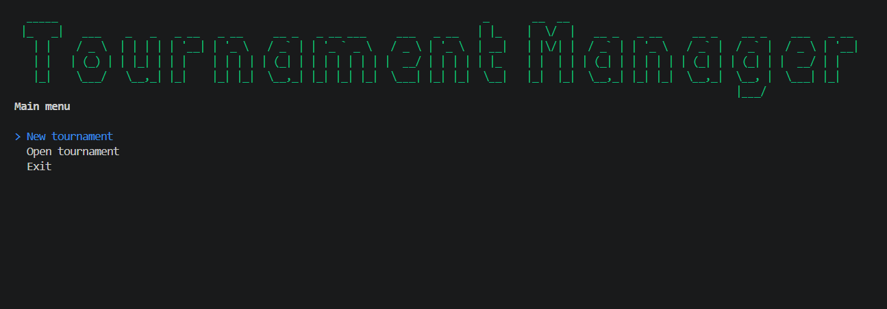

# FutsalManager-Cli

Console application to manage a five-a-side or seven-a-side football tournaments, built with C# / .NET to practice object-oriented design.

## Features
- Single round-robin tournaments (one leg)
- Teams, players and scorers
- Automatic schedule generation
- Live standings with tie-break rules
- Top scorers table
- JSON persistence

## Tech stack
C#, .NET 10, Spectre.Console, xUnit, GitHub Actions(TODO)
