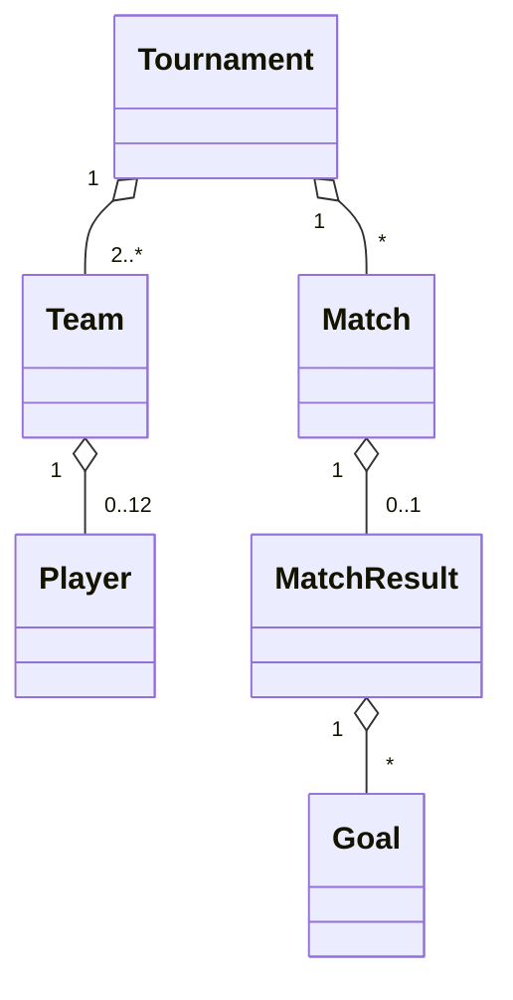

# 02 — Requirements

## Goal

A terminal application to organize a **five-a-side football tournament in a single round-robin format (one leg only)**: register teams and players, generate the schedule, enter results and scorers, and view the standings and top scorers. Data is saved to a file.

## Glossary

| Term (as used in the code) | Meaning |
|---|---|
| Tournament | A tournament, with a name, teams and matches |
| Team | A team, with a name and a roster of players |
| Player | A player on a team |
| Match | A match between two teams, in a given round |
| Round | A matchday of the schedule |
| MatchResult | The result of a match: home goals, away goals, scorers |
| Goal | A goal, with the team and the player who scored it |
| Standings | The league table |
| Round robin | Format in which every team plays all the others |

## Functional requirements (v1)

| ID | Requirement | Acceptance criterion |
|---|---|---|
| FR-01 | Create a tournament with a name | The name cannot be empty |
| FR-02 | Add teams to the tournament | Unique names (case-insensitive), only before the tournament starts |
| FR-03 | Add players to a team | Unique names within the team, maximum 12 players |
| FR-04 | Start the tournament by generating the schedule | At least 2 teams are required; each pair meets exactly once |
| FR-05 | Enter (or correct) the result of a match | Goals cannot be negative |
| FR-06 | Record the scorers of a match | The scorer belongs to one of the two teams; scorers do not exceed the goals scored |
| FR-07 | Show the standings | Sorted by points, then goal difference, then goals scored, then name |
| FR-08 | Show the schedule by round | Including the results already entered |
| FR-09 | Show the top scorers table | Sorted by goals, then name |
| FR-10 | Save and reopen tournaments | After closing and reopening, the data is identical |

## Business rules

- **BR-01**: win = 3 points, draw = 1 point, loss = 0 points.
- **BR-02**: a team cannot play against itself.
- **BR-03**: once the tournament has started, teams can no longer be added (the schedule would change).
- **BR-04**: rosters can still be edited after the start (a player may join late).
- **BR-05**: with an odd number of teams, one team rests in each round.
- **BR-06**: scorers are optional (only the total goals can be entered).

## Non-functional requirements

- **NFR-01**: the domain logic (`Core`) **does not contain** `Console.WriteLine` or references to files or user-interface libraries.
- **NFR-02**: the critical logic is covered by automated xUnit **tests**.
- **NFR-03**: user errors (invalid data) are reported with `DomainException` and shown with a clear message, without crashing the program.
- **NFR-04**: the save format is human-readable (indented JSON).
- **NFR-05**: the code compiles without warnings.

## Out of scope (for now)

Knockout rounds, group stage plus final, home-and-away legs, cards, own goals, several active tournaments at the same time, a web interface. These are good extensions for v2.

## Domain model



Design note: `Match` and `Goal` do not hold `Team` or `Player` objects, but their **identifiers** (`Guid`). This keeps saving to and loading from JSON simple and avoids circular references.

## Layered architecture

```
Cli  ───►  Core  ◄───  Infrastructure
 │                          ▲
 └──────────────────────────┘
Tests  ───►  Core, Infrastructure
```

- **Core** depends on nothing. It contains the models, the rules and the interfaces (such as `ITournamentRepository`).
- **Infrastructure** implements the Core interfaces (saving to JSON).
- **Cli** is the terminal interface and wires everything together.
- **Tests** verifies Core and Infrastructure.

This rule ("dependencies point towards Core") applies the Dependency Inversion Principle. It lets you replace the terminal with a Web API without touching the logic.